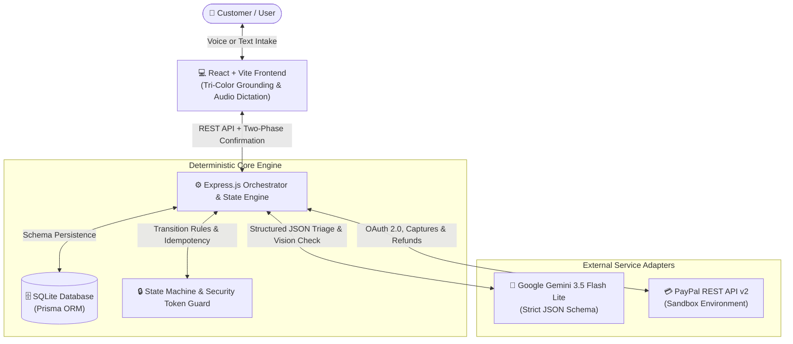

# RefundPilot AI — Intelligent Refund & Dispute Resolution Copilot 🚀

> **AI-assisted refund resolution and case-management system for PayPal transactions.**  
> Bridges natural language customer intake with deterministic business rules, authoritative PayPal REST verification, and human-in-the-loop security controls.

---

## 🌟 Key Capabilities

1. **Natural Language Intake**: Customers explain their purchase issue in everyday words (or via voice dictation). RefundPilot classifies the issue (`DAMAGED_ITEM`, `NOT_RECEIVED`, `WRONG_ITEM`, etc.), extracts order references, and identifies missing evidence.
2. **Tri-Color Grounding**:
   - 🟢 **Verified Facts**: Authoritative live status directly from the PayPal REST API (Capture ID, captured amount, payment state).
   - 🟡 **Customer Claims**: Unverified user statements and a checklist of missing evidence.
   - 🔵 **AI Guidance & Policy**: Action recommendations, return windows, and merchant policies with clear disclaimers.
3. **Safe Execution Guard**:
   - AI models **cannot** trigger financial transactions autonomously.
   - Refunds require explicit human confirmation bound by a single-use, 10-minute expiring cryptographic token.
4. **Deterministic State Machine**:
   - Strictly enforced transitions: `NEW` → `INVESTIGATING` → `MERCHANT_ACTION_REQUIRED` → `MERCHANT_RESPONSE_RECEIVED` → `RESOLVED`.
   - Prevents unauthorized jumps or model overrides (e.g., closing a case does not imply a refund was completed).
5. **Traceable Audit Timeline**:
   - Append-only event history tracking every action, AI inference, merchant interaction, and verified PayPal API response.
6. **Dispute Packet Exporter**:
   - Generates a formal Markdown evidence packet with transaction timestamps and evidence lists ready for PayPal Resolution Center submission.

---

## 🛠️ Architecture & Tech Stack



- **Frontend**: React 18, Vite, Lucide Icons, Vanilla CSS (with native Light & Dark mode support).
- **Backend**: Node.js v22, Express, Prisma ORM, SQLite (`dev.db`).
- **AI Orchestration**: Google Gemini 3.5 Flash Lite with structured JSON schema outputs (`responseMimeType: "application/json"`), multimodal visual inspection, and prompt injection defense.
- **Payment Gateway**: PayPal v2 REST API (OAuth 2.0, Captures, Refunds) in Sandbox mode.

---

## ⚡ Quickstart

### 1. Configure Environment Variables

Edit `server/.env` with your PayPal Sandbox and Gemini API credentials:

```env
PORT=5000
PAYPAL_CLIENT_ID=your_paypal_sandbox_client_id
PAYPAL_CLIENT_SECRET=your_paypal_sandbox_client_secret
PAYPAL_BASE_URL=https://api-m.sandbox.paypal.com
GEMINI_API_KEY=your_gemini_api_key
DATABASE_URL="file:./dev.db"
APP_BASE_URL=http://localhost:5173
```

*(Note: The application includes offline fallbacks and labeled fixtures so it can also be evaluated in offline mode).*

### 2. Start Backend & Frontend

Open two terminals:

**Terminal 1 (Backend Server):**
```bash
npm run server
# Server starts at http://localhost:5000
```

**Terminal 2 (Frontend Client):**
```bash
npm run client
# Vite app opens at http://localhost:5173
```

---

## 🎬 Interactive Walkthrough Demo

1. Open **`http://localhost:5173`**.
2. **Launch a Quick Scenario**:
   - Click the **"Cracked Audio Headphones"** card (or click **"Load Sample Case"** in the top navigation).
3. **Review Grounded Tri-Color Insights**:
   - 🟢 **Verified Facts**: PayPal Capture `DEMO-CAP-SONY1000`, `$399.00 USD` (COMPLETED).
   - 🟡 **Customer Claims**: Cracked earcup, missing photo evidence.
   - 🔵 **AI Guidance**: Seller contact recommended prior to dispute escalation.
4. **Attach Evidence**:
   - In the **Evidence Vault**, upload a defect image. Gemini performs an automated visual check and logs an `EVIDENCE_UPLOADED` event.
5. **Coordinate with Merchant**:
   - Under **Merchant Resolution Hub**, click **"AI Draft Inquiry"** to generate a polite message, then approve and send.
   - Use the **Simulate Merchant Response** dropdown, select **"Merchant: Accept Claim"**, and record the reply. The case advances to `MERCHANT_RESPONSE_RECEIVED`.
6. **Authorize Refund**:
   - Click **"Execute PayPal Sandbox Refund"**.
   - Review the target capture and the single-use authorization token in the confirmation modal.
   - Click **"Confirm & Authorize Refund"** to execute the refund against PayPal Sandbox. The payment status updates to `REFUNDED` and the case transitions to `RESOLVED`.
7. **Export Dispute Packet**:
   - Click **"Export Dispute Packet"** in the top bar to download the complete case history as a formatted Markdown dispute document.

---

## 🧪 Automated Verification Suite

Run our assert-based self-checks covering state rules, AI extraction, and end-to-end flows:

```bash
# Test 1: State Machine & Transition Rules
npm run test:state

# Test 2: AI Structured Extraction & Prompt Injection Guard
npm run test:ai

# Test 3: End-to-End Resolution Journey
npm test

# Verify PayPal Sandbox credentials
npm run verify:paypal
```
